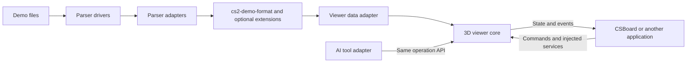

# Roadmap

[Design and proposed interfaces / 设计与接口草案](docs/library-design.md) · [Format integration / 格式接入](docs/demo-format.md)

Baseline: **CSBoard 1.21.2**. Format integration is in progress on `feature/demo-format`; the experimental private viewer extraction has completed its current integration and qualification scope on `feature/viewer-library`; neither SDK nor format integration has shipped yet. Milestones describe completion criteria, not release dates.

## Direction

Make parsed Demo data portable, expose a reusable 3D viewer, and give applications, scripts and AI the same documented operation API.

Storage, networking, collaboration, assistant sessions and application panels remain host responsibilities.

## Milestones

### 1. Define the shared contracts

- [x] Map current replay, utility, voice and custom-recording fields to the format.
- [x] Define coordinate units, time bases, player identities and missing-data semantics.
- [ ] Draft the viewer's data source, commands, queries, capabilities and events.

**Complete when:** supported fields and gaps are documented, and native/WASM paths agree on the same normalized data shape.

### 2. Integrate the data format

Branch: `feature/demo-format`. Use the planned [`dlwm/cs2-demo-format`](https://github.com/dlwm/cs2-demo-format) fork, pinned to a reviewed revision or release.

- [x] Add package import/export and preserve existing local archives and caches.
- [x] Share the Go adapter between native and WASM transports; expose an adapter interface for other parsers.
- [x] Add capability declarations and optional extensions for freeze time, custom clips, input records, actual utility effects and voice.
- [ ] Propose focused compatibility changes to the upstream project with schemas, examples and validation rules.

Current implementation imports v3 and a separate experimental replay profile; exports use the replay profile. The fork proposal is committed locally and not pushed. Go process, WASM and embedded hosts now use the experimental [parser session API](docs/parser-interface.md); an additional parser implementation and an upstream PR remain pending.

**Complete when:** standard packages can be exchanged and unsupported data is reported explicitly without silently losing existing CSBoard features.

### 3. Extract the viewer core

Branch: `feature/viewer-library`, currently carrying the uncommitted format integration as its dependency. See [implemented scope and remaining migration](docs/viewer-library.md).

- [ ] Separate rendering, data access and interaction from the current application component.
- [ ] Inject data and resource loaders; keep parser, storage, Yjs and AI dependencies outside the core.
  - [x] Introduce a renderer-neutral replay source with segment leases and batched tracks; migrate application round reads and provide direct replay-profile package access.
  - [x] Consume neutral tracks in the independent renderer and inject asynchronous map resource leases.
  - [x] Share map display materials, bounded batching, object trees/visibility and host-supplied floor ranges.
  - [ ] Finish migration of application playback/HUD, model simplification and auxiliary map controls.
- [ ] Support incremental data loading, seeking, cameras, map layers, players and utility effects.
  - [x] Play selected neutral segments with seeking, speed, player interpolation, recorded smoke/fire and progressive trajectories using shared implementations.
  - [x] Share first-person camera math and budgeted monitor rendering; provide follow/monitor commands and host layout injection.
  - [x] Share neutral player presentation, icon identities and SVG firearm geometry; expose HUD data and injected firearm assets.
  - [x] Index per-player timeline queries and share reload, damage, flash and weapon-motion presentation across hosts.
  - [x] Share indexed C4 state/markers and director event selection/camera pose math across hosts.
  - [x] Add public standalone director commands, observable availability and camera restore/mode coordination.
  - [x] Adopt the shared director/POV camera controllers in CSBoard and route replay director UI through public commands.
  - [x] Share hurt/flash screen presentation and DOM layers across React and standalone hosts, with primary-view bounds and effect controls.
  - [x] Extract speaking indexes, audio-clock scheduling and a context-injected Web Audio driver; adopt them in application voice playback.
  - [x] Integrate injected voice decoder/driver ports into standalone replay commands, state/events and cancellation-aware lifecycle.
  - [x] Adopt the shared voice coordinator and expose application voice settings/state/events through the public command entry.
  - [ ] Finish streaming/byte budgets, remaining equipment/HUD overlays, director orchestration, auxiliary map resource drivers and full host migration.
- [x] Provide deterministic teardown, multiple viewer instances and an independent example application for NAV/player/camera rendering.

**Complete when:** another application can display standard data without importing CSBoard's workspace, platform globals or React UI.

### 4. Publish operations and events

- [ ] Expose typed commands, state queries, capabilities, results and errors.
  - [x] Add runtime contract discovery with registered command schemas, host profiles and explicit incomplete-schema markers.
  - [x] Add a shared editable player layout/query, lightweight utility-reference projection and a matching player-layout event schema across hosts.
  - [x] Add injectable utility catalogue/lease/placement drivers, application reference bridge and placement event schemas with cancellation and workspace guards.
  - [x] Migrate application utility adding (UI and existing AI tool) with asynchronous preparation and a synchronous collaboration commit hook.
  - [x] Verify local WebSocket desktop/web utility synchronization, stale revision rejection, leave/rejoin, and independent consumer rendering/lifecycle.
  - [x] Document the experimental compatibility boundary; retain host-specific legacy formats explicitly.
- [ ] Define transactions, revision checks, cancellation and undo/redo for editable operations.
- [ ] Expose selection, hover, drag, camera, playback, object, resource and lifecycle events.
- [ ] Add host approval hooks, event provenance, subscription cleanup and configurable high-frequency delivery.
- [ ] Adapt existing AI tools to the public API; keep prompts, sessions and model providers outside the viewer.
  - [x] Provide a provider-neutral tool adapter and external command example using execute, policy, revisions and cancellation.
  - [ ] Migrate the application tactical tools to this adapter after host-specific contracts are defined.

**Complete when:** UI, scripts and AI can perform equivalent operations and observe their results through the same contract, without feedback loops or hidden application dependencies.

### 5. Adopt and distribute

- [ ] Make CSBoard consume the library through its public interfaces.
- [ ] Offer an optional React wrapper and minimal examples for viewing, editing and AI integration.
- [ ] Document compatibility, migration, API/schema versions and package licensing.
- [ ] Compare memory use, initial load, seek latency and multi-view rendering with the current application.
- [ ] Continue model-size and runtime-memory improvements within the shared resource/rendering architecture.

**Complete when:** the independent examples and CSBoard use the same library, and published packages have documented dependencies, capabilities and compatibility boundaries.

## Working rules

- Stabilize data contracts before independently implementing another viewer data model.
- Add compatible optional format capabilities where possible; do not require every consumer to implement CSBoard's extensions.
- Keep ZIP packaging at the exchange boundary rather than in the render loop.
- Version the format and viewer API separately; do not claim an application release number is an API compatibility guarantee.
- Changes to the roadmap do not themselves create branches, replace dependencies or publish packages.
