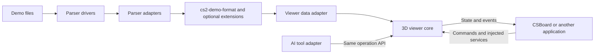

# Roadmap

[Design and proposed interfaces / 设计与接口草案](docs/library-design.md)

Baseline: **CSBoard 1.21.2**. The work below is planned; no independent viewer SDK or new format integration has shipped yet. Milestones describe completion criteria, not release dates.

## Direction

Make parsed Demo data portable, expose a reusable 3D viewer, and give applications, scripts and AI the same documented operation API.

Storage, networking, collaboration, assistant sessions and application panels remain host responsibilities.

## Milestones

### 1. Define the shared contracts

- [ ] Map current replay, utility, voice and custom-recording fields to the format.
- [ ] Define coordinate units, time bases, player identities and missing-data semantics.
- [ ] Draft the viewer's data source, commands, queries, capabilities and events.

**Complete when:** supported fields and gaps are documented, and native/WASM paths agree on the same normalized data shape.

### 2. Integrate the data format

Branch: `feature/demo-format`. Use the planned [`dlwm/cs2-demo-format`](https://github.com/dlwm/cs2-demo-format) fork, pinned to a reviewed revision or release.

- [ ] Add package import/export and preserve existing local archives and caches.
- [ ] Share the Go adapter between native and WASM transports; expose an adapter interface for other parsers.
- [ ] Add capability declarations and optional extensions for freeze time, custom clips, input records, actual utility effects and voice.
- [ ] Propose focused compatibility changes to the upstream project with schemas, examples and validation rules.

**Complete when:** standard packages can be exchanged and unsupported data is reported explicitly without silently losing existing CSBoard features.

### 3. Extract the viewer core

Branch: `feature/viewer-library`, based on the stable format integration.

- [ ] Separate rendering, data access and interaction from the current application component.
- [ ] Inject data and resource loaders; keep parser, storage, Yjs and AI dependencies outside the core.
- [ ] Support incremental data loading, seeking, cameras, map layers, players and utility effects.
- [ ] Provide deterministic teardown, multiple viewer instances and an independent example application.

**Complete when:** another application can display standard data without importing CSBoard's workspace, platform globals or React UI.

### 4. Publish operations and events

- [ ] Expose typed commands, state queries, capabilities, results and errors.
- [ ] Define transactions, revision checks, cancellation and undo/redo for editable operations.
- [ ] Expose selection, hover, drag, camera, playback, object, resource and lifecycle events.
- [ ] Add host approval hooks, event provenance, subscription cleanup and configurable high-frequency delivery.
- [ ] Adapt existing AI tools to the public API; keep prompts, sessions and model providers outside the viewer.

**Complete when:** UI, scripts and AI can perform equivalent operations and observe their results through the same contract, without feedback loops or hidden application dependencies.

### 5. Adopt and distribute

- [ ] Make CSBoard consume the library through its public interfaces.
- [ ] Offer an optional React wrapper and minimal examples for viewing, editing and AI integration.
- [ ] Document compatibility, migration, API/schema versions and package licensing.
- [ ] Compare memory use, initial load, seek latency and multi-view rendering with the current application.
- [ ] Continue model-size and runtime-memory improvements within the shared resource/rendering architecture.

**Complete when:** the independent examples and CSBoard use the same library, and published packages have documented dependencies, capabilities and compatibility boundaries.

## Working rules

- Stabilize data contracts before independently implementing another viewer data model.
- Add compatible optional format capabilities where possible; do not require every consumer to implement CSBoard's extensions.
- Keep ZIP packaging at the exchange boundary rather than in the render loop.
- Version the format and viewer API separately; do not claim an application release number is an API compatibility guarantee.
- Changes to the roadmap do not themselves create branches, replace dependencies or publish packages.
