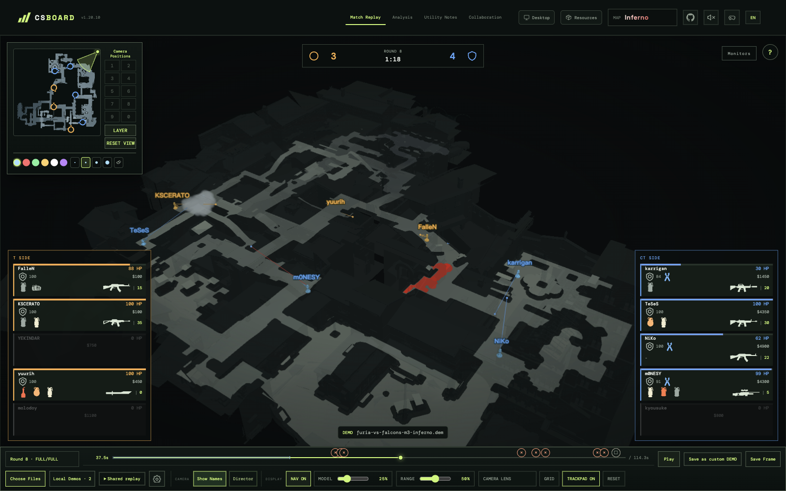
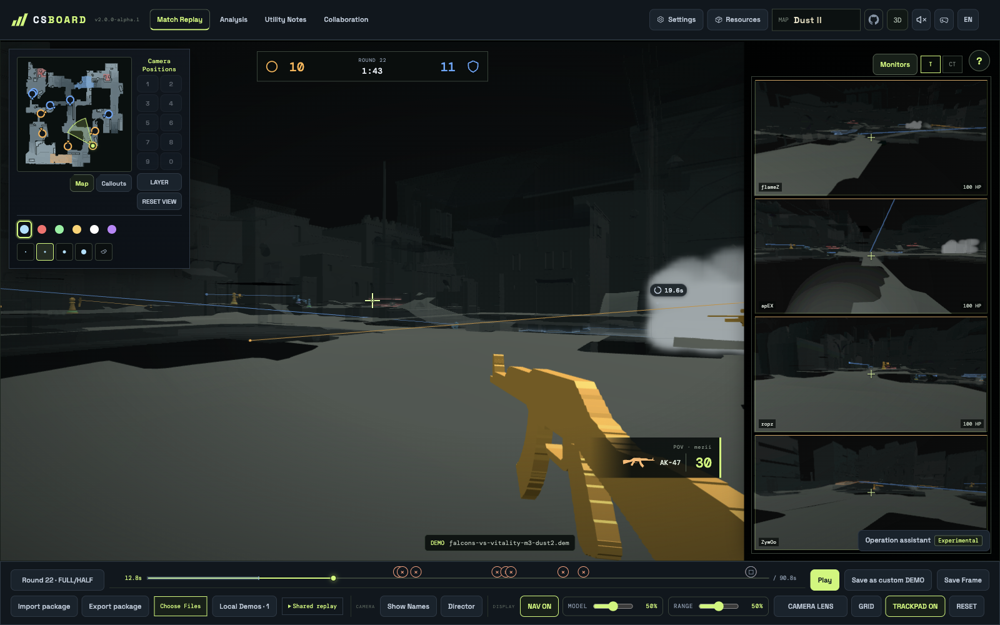
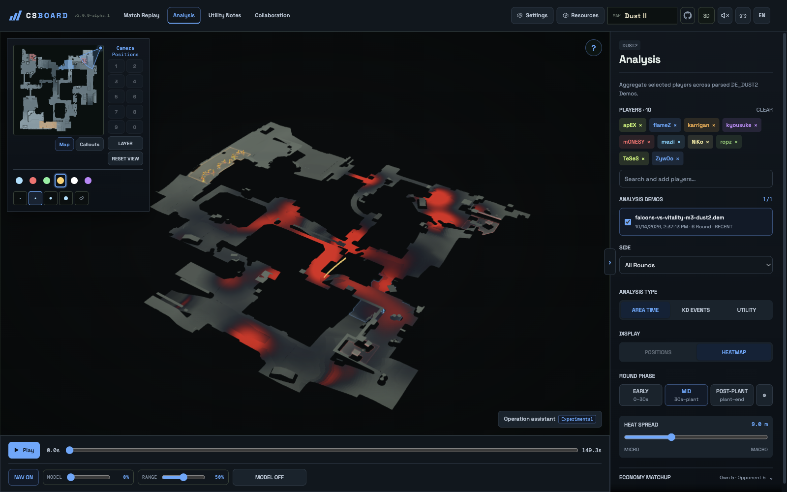
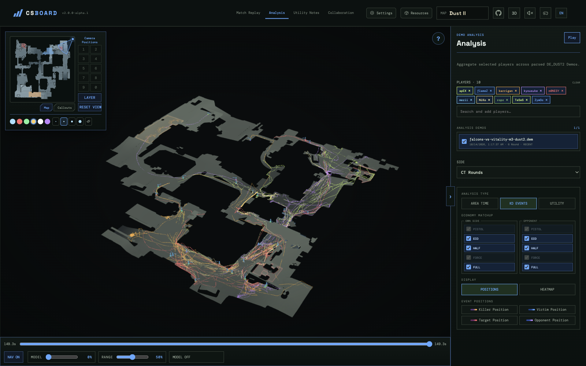
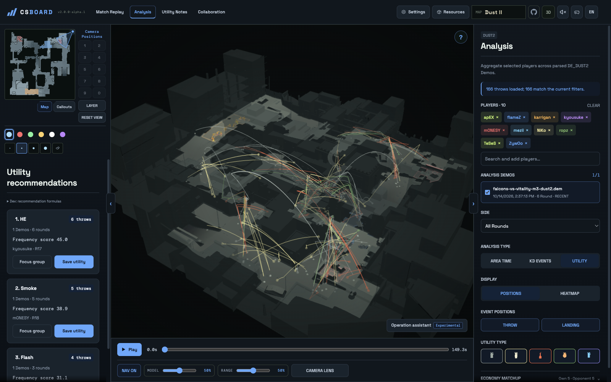
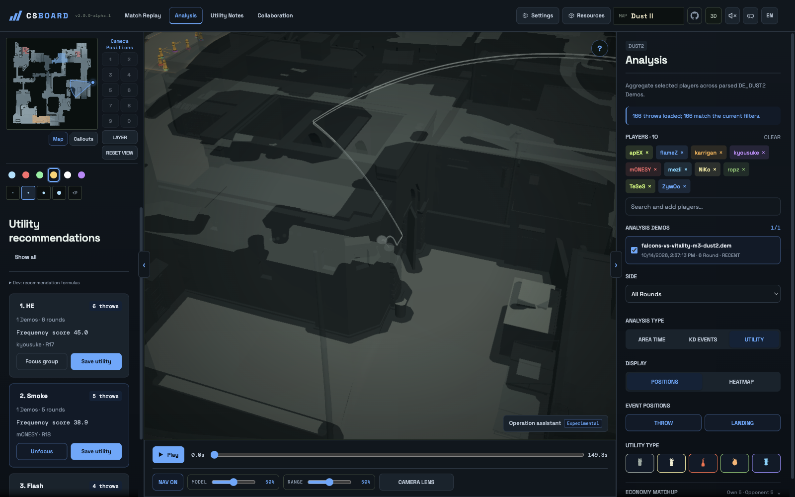
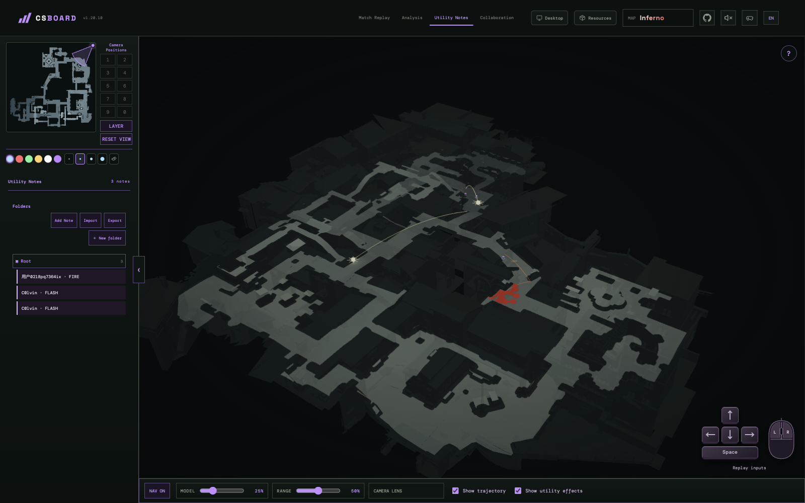
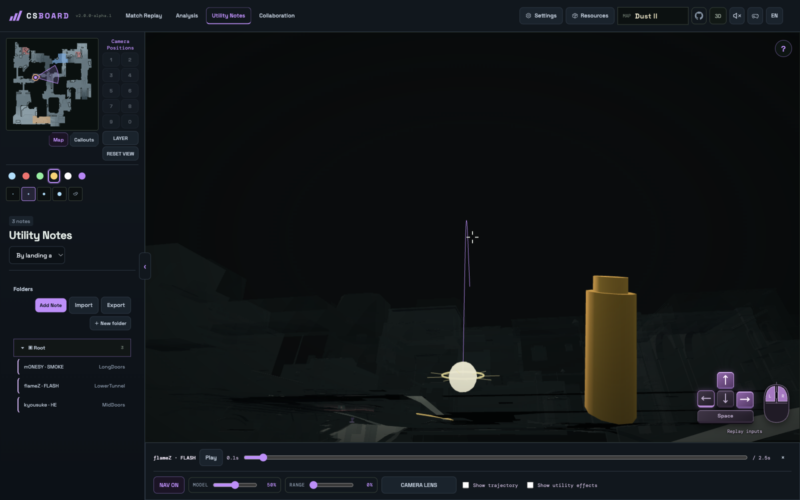
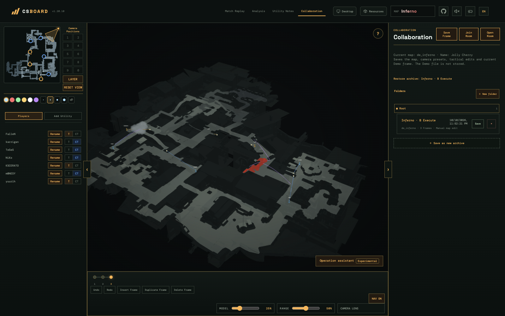
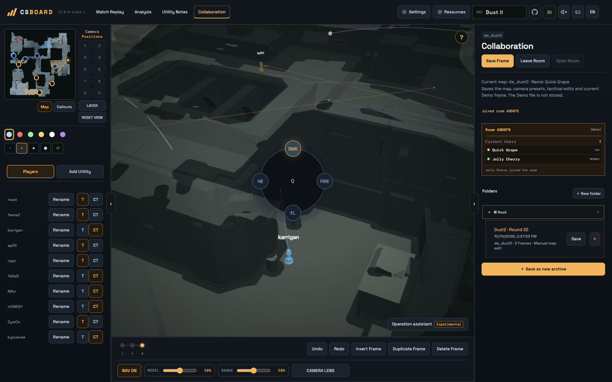

# CSBoard

用于 CS2 Demo 回放、数据分析、道具速记和多人协作的工具。

[English](../README.md) · [Русский](README.ru-RU.md) · [桌面端下载](https://github.com/dlwm/csBoard/releases/latest)

> **2.0 预览版：** [2.0.0-alpha.1](https://github.com/dlwm/csBoard/releases/tag/v2.0.0-alpha.1)。接入接口仍为实验性；桌面端下载链接指向正式版。

## 从这里开始

| 你想做什么 | 文档入口 |
| --- | --- |
| 使用 CSBoard | [用户使用手册](user-guide.zh-CN.md)：回放、分析、速记、协作与操作方式 |
| 理解结构或参与开发 | [开发者指南](developer-guide.zh-CN.md)：架构、驱动与独立库的边界 |
| 在本机运行或打包 | [本地构建指南](build-guide.zh-CN.md)：开发命令、打包与 CI |
| 在自己的项目中引用视图库 | [最小接入示例](../packages/viewer/examples/minimal/README.md) · [接口与兼容范围](viewer-compatibility.md) |
| 查看更新和后续方向 | [更新日志](CHANGELOG.zh-CN.md) · [路线图](../ROADMAP.md) |

## 对局回放

按回合播放导入的 Demo，查看人员位置、道具效果和战斗事件，通过时间线跳转到指定时刻。

- 在地图总览、选手第一人称与队友监视器之间切换，对照不同人的视角。
- 拖回冻结阶段观察开局准备，查看烟雾剩余时间，按阵营筛选已记录的语音。
- 保存当前帧到协作面板继续编辑，或将时间段保存为独立的自制 DEMO。

<table>
<tr>
<td width="50%" valign="top">

回合总览：人员、道具与时间线

</td>
<td width="50%" valign="top">

队友监视器：对照多个第一人称视角

</td>
</tr>
</table>

## 数据分析

汇总所选选手在多个回合中的移动、击杀、死亡和道具事件，支持按阵营和经济条件筛选。道具推荐会将相似投掷分组，显示出现次数，并支持保存代表道具。

- 按开局前期、中期和下包后查看区域停留热力。
- 查看击杀与死亡位置，分别设置己方和对方的经济筛选条件。
- 按选手、阵营、回合和道具类型筛选，查看起点、落点与飞行轨迹。
- 相似投掷按集合推荐，展示实际次数，并从集合中选择代表道具。
- 聚焦某个集合查看轨迹和效果，将代表投掷保存到道具速记。

<table>
<tr>
<td width="50%" valign="top">

区域时间：按回合阶段查看停留热力

</td>
<td width="50%" valign="top">

KD 事件：位置、阵营与经济筛选

</td>
</tr>
<tr>
<td width="50%" valign="top">

跨回合分析：轨迹与高频道具推荐

</td>
<td width="50%" valign="top">

聚焦集合：相似烟雾的轨迹与效果

</td>
</tr>
</table>

## 道具速记

从数据分析保存投掷，或通过 getpos 手动添加速记。导入的投掷保留准备动作、移动、出手、飞行轨迹与效果，支持回放查看。

- 用文件夹整理，按落点区域排序，保留来源选手、回合与坐标。
- 用聚光灯查看落点和周围掩体，或第一人称回放投掷并查看记录的按键。
- 复制 getpos，在游戏中复现起始位置与瞄准角度。

<table>
<tr>
<td width="50%" valign="top">

速记详情：来源信息与落点预览

</td>
<td width="50%" valign="top">

第一人称回放：按键与投掷进度

</td>
</tr>
</table>

## 协作面板

在地图上添加和移动人物、放置道具、绘制路线。可以导入已保存的回放帧继续编辑，也可以开放房间与其他用户共同操作。

- 切换三维或二维视图，查看人员位置、视线和掩体。
- 保存、复制和切换帧，添加道具速记中已保存的投掷。
- 开放或加入房间共同编辑，查看在线用户，实时同步修改。

<table>
<tr>
<td width="50%" valign="top">

帧编辑：二维视图中的人员布局

</td>
<td width="50%" valign="top">

共享房间：实时编辑与道具轮盘

</td>
</tr>
</table>

## 数据与许可

Demo、分析缓存、存档与道具速记保存在本机；协作与共享回放需要服务器。可选实验性操作助手向配置的服务发送请求上下文，资源下载与应用更新也需联网。

原创源码与文档采用 [GPL-3.0-only](../LICENSE)，第三方依赖保留各自许可，见 [第三方说明](THIRD_PARTY_NOTICES.md)。
