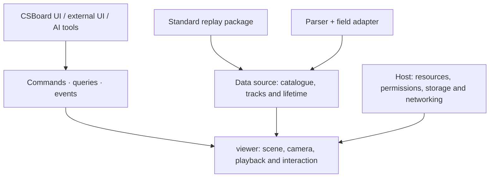

# Developer guide

[Home](../README.md) · [中文](developer-guide.zh-CN.md) · [Local builds](build-guide.md)

## Understand the boundaries

CSBoard is a host application. `@csboard/viewer` is an independently usable viewer: it contains Three.js rendering, but not React panels, parsers, databases, room servers or AI services. Another application can bring its own UI and data sources.

| Area | Location | Responsibility |
| --- | --- | --- |
| Application features | `src/main.jsx`, `src/demo`, `src/analysis`, `src/utility`, `src/collaboration` | Panels, filters, workflows and archive semantics |
| Workspace layout | `src/components/workspace` | Shared header, sidebar, footer, corner and popover slots |
| Platform assembly | `src/platform/hosts`, `assembly`, `drivers` | Shell capabilities and parser/compute/storage composition |
| Parsing semantics | `native/parser`, `src/demo/parsers` | Go protocol, missing values, player/event conversion |
| Format boundary | `src/formats`, `config/formats` | Standard validators and application cache integration |
| Viewer | `packages/viewer` | Standalone scenes, resource leases, public operations and callbacks |
| Desktop and services | `electron`, `native/storage`, `server` | IPC, native persistence, collaboration and deployment |

## Drivers, formats and sources

A **driver** controls execution: WASM, native process or embedded runtime, input, progress, cancellation and release. A **field adapter** defines meaning: producer-specific identities, coordinates, time and events become agreed fields. Go native and WASM transports share semantics rather than duplicating them per shell.

`cs2-demo-format` defines exchange data. `ReplayDataSource` defines how to read it and manage its lifetime. A standard ZIP opens directly through `@csboard/viewer/format`, without conversion to a CSBoard cache. Original Demos and legacy caches still need their own readers/adapters. Unknown data must not become fabricated zero values.

## Public operations and AI

Prefer public commands for UI, external consumers and AI tools. Inspect `getCapabilities` / `getContract`, check structured `execute` results and unsubscribe on disposal. Include `expectedRevision` when editing; reread after conflicts. Hosts own permissions, approval, persistence and network identity.

Public layouts use scene metres and radians; explicitly convert Source coordinates. Built-in command schemas are validated before approval or mutation. Partial/unknown host payloads are not universal schemas; runtimeValidation=host marks host-owned validation. Event descriptors include payload schemas; regenerate static validators with make viewer-contracts after contract changes. Some application operations remain host-specific; do not exchange whole snapshots across profiles.

## Working conventions

- Register new panels through workspace slots and existing controls.
- Share trajectory, smoke, playback and camera code; keep React focused on UI/state adapters.
- Add parser ports and field adapters instead of parser/OS branches in panels.
- Cancel or reject stale asynchronous work after map, round or source changes.
- Specify ownership and release of segments, Workers, subscriptions and GPU resources. Models remain optional.
- Update assertions and test doubles with behavior changes. Check packaged dependencies and IPC using an actual application launch.

## Workspace UI primitives

`src/components/workspace/WorkspaceControls.jsx` provides `WorkspaceButton` (primary, secondary, quiet and selected states), `WorkspacePanelHeading`, and `WorkspaceSection` (optional native disclosure). Feature code supplies translated labels, state and handlers. All menus and portal dialogs share design tokens in `theme.css` and controls in `controls.css`; chrome layout lives in `workspace.css`. Module styles own only their content. Use the shared components for ordinary buttons and text fields (`workspace-input`); reserve native custom controls for timelines, color swatches and in-scene markers. Register playback in `bottom-transport`, display controls in the existing settings slots, and sidebar content through the workspace registry. Avoid positioning feature controls relative to the window.

## Further reading

- [Minimal independent consumer](../packages/viewer/examples/minimal/README.md): start here for another application.
- [Package API](../packages/viewer/README.md), [compatibility scope](viewer-compatibility.md).
- [Parser interface](parser-interface.md), [data format](demo-format.md).
- [Design](library-design.md): architectural boundaries; consult the API and compatibility guide for implemented behavior.
- [Testing](../tests/README.md), [AI corpus](ai/README.md), [preset data](presets/README.md).

The viewer is a private experimental package, API 0.2, not published to npm. It uses GPL-3.0-only; read the [license](../LICENSE) and [third-party notices](THIRD_PARTY_NOTICES.md) before integrating or distributing it.

## Interface text and errors

Application translations live in `src/i18n/locales/{en,zh,ru}` and are grouped by feature. Add the same key and named placeholders to all three dictionaries; components use `translate(language, 'replay.example', { count })` or a bound `createTranslator(language)`. Use `translateParts` for React nodes, not HTML inside translated strings. Legacy keys remain readable through the existing `src/i18n.js` import path.

Store a key plus values for asynchronous notices, rather than the translated sentence. Translate when rendering so changing language does not restart work or leave old-language status text. Worker progress sends `{ code, values }`; technical diagnostics retain their original text. Use `formatNumber`, `formatBytes` and `formatDuration` for display; never localize serialized coordinates, IDs or `getpos` commands.

The viewer package does not depend on application dictionaries. Keep its error codes, operation results and schemas stable. The host can use `translateError` for a known code and retain `message` / `details` for diagnosis. Unknown errors keep their original message; do not infer codes by matching translated sentences or retry an operation just because its display text changed.

`make i18n-check` checks dictionary keys, duplicate keys, placeholders, compatibility aliases and source references. It is also included in `make lint` and the existing release checks. Dynamic message selection must use registered keys; third-party error messages and user content are not translation keys.

Full viewport charts register content in `viewport-content` and select the shell's `viewportMode="panel"`. The workspace owns sizing and scrolling; keep filter/evidence panels in the existing sidebars. Retain the scene instance and set the host board's `renderEnabled={false}` while it is covered. Keyboard shortcuts must yield to focused input, select, textarea, button and editable controls.
