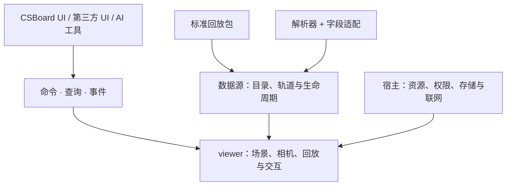

# 开发者指南

[首页](README.zh-CN.md) · [English](developer-guide.md) · [本地构建](build-guide.zh-CN.md)

## 先理解边界

CSBoard 是一个宿主应用；`@csboard/viewer` 是可以独立接入的视图库。库包含 Three.js 渲染，但不包含 React 面板、Demo 解析器、数据库、房间服务器或 AI 服务。另一个应用可以用自己的 UI 和数据源展示同样的场景。

| 层 | 位置 | 应当负责 |
| --- | --- | --- |
| 应用与功能 | `src/main.jsx`、`src/demo`、`src/analysis`、`src/utility`、`src/collaboration` | 页面、筛选、工作流、存档语义 |
| 工作区布局 | `src/components/workspace` | 顶栏、侧栏、底栏、角落和弹出层的统一插槽 |
| 平台装配 | `src/platform/hosts`、`assembly`、`drivers` | 壳能力与解析、计算、存储驱动的组合 |
| 解析与语义 | `native/parser`、`src/demo/parsers` | Go 运行协议、缺失值、人物和事件的转换 |
| 数据格式 | `src/formats`、`config/formats` | 标准格式校验与应用缓存的边界 |
| 视图库 | `packages/viewer` | 独立场景、资源租约、公开操作与回调 |
| 桌面与服务 | `electron`、`native/storage`、`server` | IPC、原生数据、协作与部署 |

## 驱动、格式、数据源分别解决什么

**驱动**负责“怎么运行”：WASM、原生进程或嵌入式调用，输入、进度、取消和释放。**字段适配**负责“代表什么”：不同解析器的数据转为约定的身份、坐标、时间和事件。同一个 Go 解析器的 native/WASM 共用语义，不按壳复制业务。

`cs2-demo-format` 是交换数据合同；`ReplayDataSource` 是读数据的方法和生命周期。标准 ZIP 可直接通过 `@csboard/viewer/format` 打开，不需要先转换成 CSBoard 私有缓存。原始 Demo 或旧缓存仍需各自的读取/适配路径。缺失字段保持未知，不能填零伪装成真实数据。

## 外部调用与 AI

UI、第三方调用和 AI 工具尽量汇入公开命令。使用 `getCapabilities` / `getContract` 查询支持范围，`execute` 检查结构化结果，事件订阅在销毁时解除。编辑携带 `expectedRevision`，冲突后重读；宿主负责权限、审批、持久化和网络身份。

公开布局使用场景米坐标与弧度，Source 原始坐标需明确转换。合同中标记 partial/unknown 的部分不是通用稳定协议；发现清单也不能代替参数校验。当前应用仍有宿主专属操作，不要直接交换不同 profile 的完整快照。

## 改功能时从哪里入手

- 新面板使用工作区插槽与已有控件，不另造侧栏布局和弹出层层级。
- 相同轨迹、烟体、播放和相机行为优先复用视图库；React 留作状态与界面适配。
- 新解析器实现解析端口与字段适配，避免在 UI 中分支判断解析器或操作系统。
- 异步切换必须有取消/代次保护；切地图、切回合和销毁后，旧结果不得覆盖当前状态。
- 资源、片段、Worker、事件和 GPU 对象明确谁创建、谁释放；不要将可选模型变为启动必需项。
- 修改实际行为就核对断言与测试替身；打包依赖和原生桥接要用真实产物启动检查。

## 工作区视觉组件

`src/components/workspace/WorkspaceControls.jsx` 提供 `WorkspaceButton`（主操作、普通、轻量和选中状态）、`WorkspacePanelHeading` 与 `WorkspaceSection`（可选原生折叠）。业务传入国际化文字、状态与事件。所有菜单和弹窗共享 `theme.css` 的设计变量与 `controls.css` 的控件样式；栏布局放在 `workspace.css`，模块样式只负责内容。普通按钮统一使用共享组件，文本输入使用 `workspace-input`；时间轴、色板与场景标记等专用控件保留原生结构。播放注册到 `bottom-transport`，显示控件注册到现有设置插槽，侧栏内容使用工作区注册机制；不按窗口坐标定位业务控件。

## 深入阅读

- [最小独立接入示例](../packages/viewer/examples/minimal/README.md)：其他项目从这里开始。
- [包接口](../packages/viewer/README.md)、[兼容范围](viewer-compatibility.md)：当前能力与边界。
- [解析接口](parser-interface.md)、[数据格式](demo-format.md)：增加解析器或数据来源。
- [架构设计](library-design.md)：分层与边界；已实现的行为以 API 和兼容说明为准。
- [测试指南](../tests/README.md)：有效行为测试与真实打包验收。
- [AI 提示词](ai/README.md)、[预设数据](presets/README.md)：可贡献内容的位置。

视图库目前是未发布到 npm 的私有实验包，API 0.2。代码按 GPL-3.0-only 提供；引用和分发前阅读 [许可证](../LICENSE) 与 [第三方说明](THIRD_PARTY_NOTICES.md)。

## 界面文案与错误

应用词典集中在 `src/i18n/locales/{en,zh,ru}`，按功能分组。新增文案时，三种语言使用相同的键和命名占位符；组件调用 `translate(language, 'replay.example', { count })`，或使用 `createTranslator(language)`。需要插入 React 元素时使用 `translateParts`，不要在词典中嵌入 HTML。原有 `src/i18n.js` 导入入口和旧键兼容映射仍保留。

异步提示保存键和参数，在渲染时翻译，避免切换语言后保留旧文案或重新启动任务。解析进度传递 `{ code, values }`，技术诊断保留原文。界面数字、容量和耗时使用 `formatNumber`、`formatBytes`、`formatDuration`；序列化坐标、ID 和 `getpos` 指令不使用本地化格式。

视图库不依赖应用词典。保持公开错误码、操作结果与数据结构稳定；宿主可使用 `translateError` 展示已知错误，并保留 `message` / `details` 供诊断。未知错误直接展示原文，不根据翻译后的句子猜错误码，也不因为显示文案变化而自动重试操作。

`make i18n-check` 检查词典键、重复键、占位符、兼容映射及源码引用，并已纳入 `make lint` 和既有发布检查。动态选择的文案须使用词典中已有的键；第三方错误和用户输入不是翻译键。

修改公开合同后运行 `make viewer-contracts` 同步静态校验器；`make lint` 检查生成物。内置命令在审批与变更前验证参数，事件描述提供载荷 Schema。宿主自定义 profile/覆盖标记为 `runtimeValidation: host`，由宿主负责校验。
